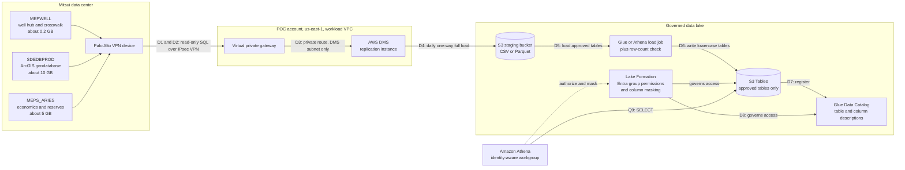
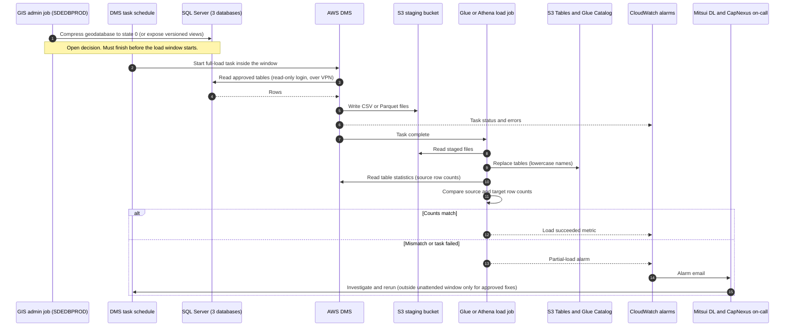
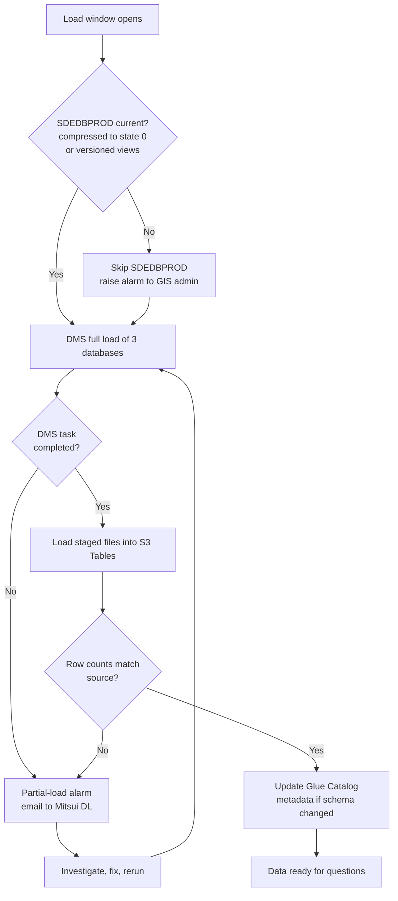
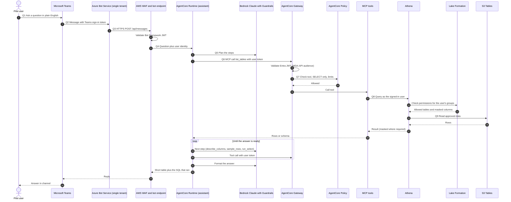
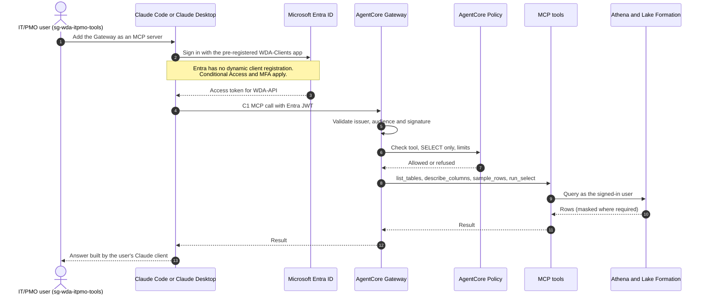
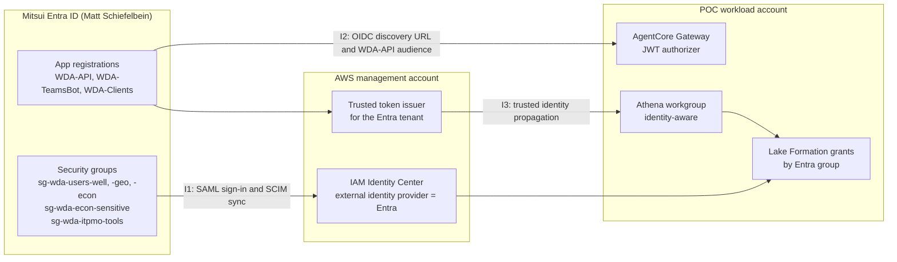
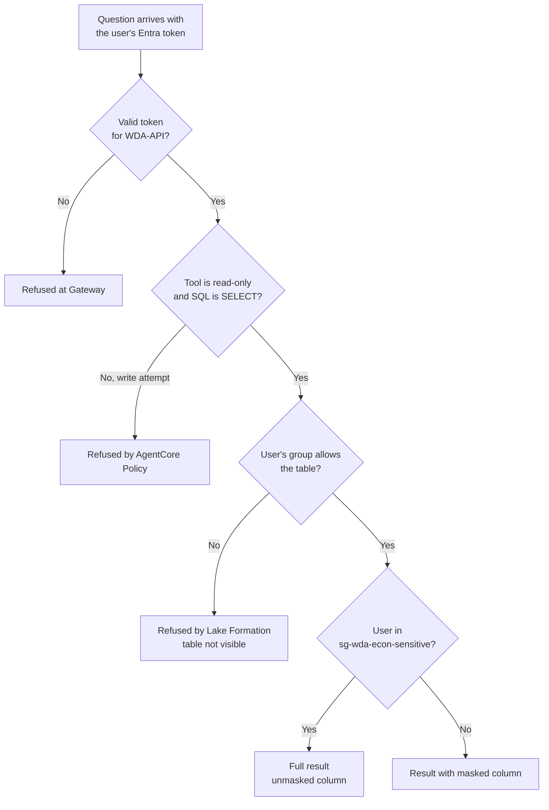
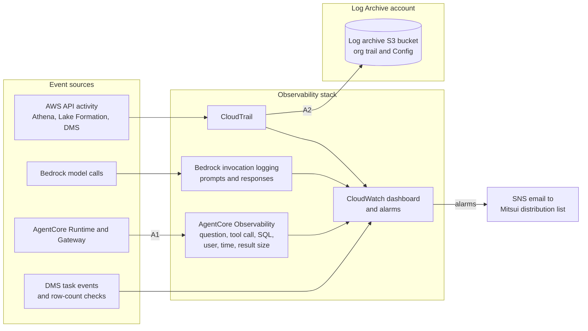
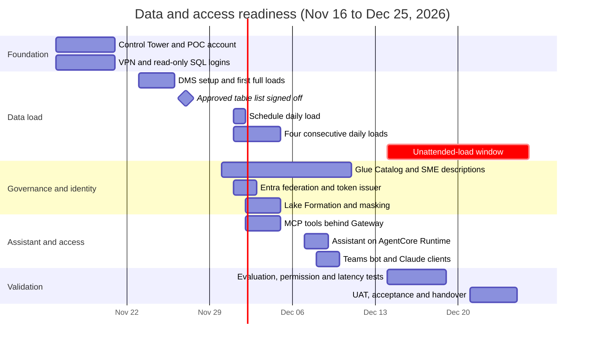

# Well Data Assistant POC: Data Workflow

Mitsui E&P USA and CapNexus, SOW Mitsui.CapNexus.SOW2026001.

This document describes how data and identity move through the Well Data Assistant POC. It pairs with the architecture diagram [WDA-POC-Architecture.drawio](WDA-POC-Architecture.drawio). Step IDs (D1 to D8, Q1 to Q9, C1, I1 to I3, A1 to A2) are the same in both files.

## 1. Sources and assumptions

Sources: the signed SOW, the Kickoff Agenda, the Client Dependencies and Sharing Strategy (rev 1.6), and the task list under `task-list/`.

Where the documents differ, this file follows the task list. The one exception is the unattended-load window: it is Mon Dec 14 to Fri Dec 25 (decided Nov 17, matching the Dependencies document). The task list was updated to match.

Assumptions made where the sources are silent. Please correct any that are wrong:

| # | Assumption | Basis |
|---|---|---|
| 1 | The compute behind the four MCP tools, and behind the Teams bot messaging endpoint, is not named in the SOW. The diagram shows them as boxes without a service icon. | SOW names AgentCore Gateway, Runtime and Policy only. |
| 2 | The load step from the S3 staging bucket into S3 Tables uses Athena or Glue, whichever the Data & Platform Engineer picks. | Dependencies doc, finding 3. |
| 3 | Row limit and timeout values enforced by AgentCore Policy are not set yet, so none are shown. | SOW says "row limits and timeouts" without numbers. |
| 4 | Daily load window is not agreed. The 1:00 to 4:00 AM Central example is only an example. | Open item 4.5. |
| 5 | The SDEDBPROD approach (compress to state 0, or versioned `_evw` views) is undecided and has no owner. Both are shown. | Open item 4.4. |

## 2. Data end to end

Mitsui data is copied once a day, one way, into the POC account. Nothing flows back to the source databases.

| Step | What happens | Control |
|---|---|---|
| D1 | DMS reads the approved tables with a SQL-authenticated, read-only login (`db_datareader`, `VIEW DATABASE STATE`, `VIEW DEFINITION`). | No `sysadmin` or `db_owner`. Credentials sit in Secrets Manager, encrypted with a customer-managed KMS key. |
| D2 | Traffic crosses the site-to-site VPN (two IPsec tunnels, Palo Alto on the Mitsui side). | Firewall allows only the DMS subnet, to a fixed TCP port per instance (default 1433). |
| D3 | The virtual private gateway routes to the DMS replication instance. | Only the DMS subnet has a route to the VPN. The assistant has no network path to the databases. |
| D4 | DMS writes CSV or Parquet to a regular S3 bucket. | DMS cannot write directly to S3 Tables, so this staging step is required. |
| D5 | A Glue or Athena job loads the approved tables from staging into S3 Tables. | Row counts are compared with the source after every load. A partial-load alarm covers DMS marking a dropped load as complete. |
| D6 | Tables are written with lowercase table and column names. | A source-to-target name mapping table is kept. Lake Formation and Glue require lowercase. |
| D7 | The tables are registered in the Glue Data Catalog with SME-written table and column descriptions. | The `describe_columns` tool reads these descriptions, so they drive SQL quality. |
| D8 | Lake Formation grants access by Entra group and masks at least one column. | Matrix signed off by Noah Jackson (tables) and Matt Schiefelbein (groups). |

## 3. Daily load run

The load runs once a day inside the agreed window. It must run without intervention for the final two weeks of the POC (Dec 14 to Dec 25).

Rules for the unattended window (task list, Week 4 and Week 5):

- No manual loads and no source or VPN maintenance from Mon Dec 14 to Fri Dec 25. Mitsui DBAs and the network team are told in advance.
- Stable daily load by Fri Dec 11 is a hard target, and Dec 7 to Dec 11 is for stabilizing it.
- The load pipeline is frozen from Dec 14. Only fixes for a failed load are allowed.
- Fri Dec 25 is a holiday and the load still runs. On Thu Dec 24 the DMS task history and alarm history for Dec 14 to Dec 24 are exported as acceptance evidence. The Dec 25 run is checked on the next business day and added.

### Load decision flow

## 4. Business question to answer (Microsoft Teams)

A pilot user asks a question in the Teams channel. The assistant writes SQL, runs it as that user, and replies with a short table and the SQL. The target is a typical answer within 60 seconds.

The assistant uses the four read-only tools in the usual order:

1. `list_tables` finds candidate tables.
2. `describe_columns` reads the SME descriptions and join hints.
3. `sample_rows` checks values and formats.
4. `run_select` runs the final SQL on Athena. Cross-database questions join MEPWELL, SDEDBPROD and MEPS_ARIES on well identifiers using the MEPWELL crosswalk tables.

## 5. IT/PMO access from Claude Code and Claude Desktop

IT/PMO users reach the same Gateway tools directly, under their own sign-in. The Teams bot and the assistant runtime are not involved.

Open item: for Claude Desktop remote connectors, requests may come from Anthropic's cloud. If so, the Gateway must be reachable from the internet and protected by the JWT authorizer. Mitsui InfoSec decides on the connection method (item 8.1, Week 3 and Week 4). Rows returned by the tools reach the Claude client and its model provider, which InfoSec must accept.

## 6. Identity and permission flow

### 6.1 One-time setup

SCIM does not sync nested groups, so group membership must be flat. The identity source is switched once, in one session (Tue Dec 1 in the task list).

Fallback (SOW Assumption 8): if the signed-in user cannot be carried through to Athena within the POC, the pilot runs on permissions by Entra group. The user is then logged at the application layer so every question still traces to a named person. Noah Jackson must accept this fallback in writing.

### 6.2 What each test user sees

The permission tests use three Entra users and run through Teams, Claude Code and Claude Desktop.

| Test user | Group membership | Expected result |
|---|---|---|
| User A | All permitted groups, including `sg-wda-econ-sensitive` | Sees all approved tables and the unmasked column. |
| User B | Permitted groups, not `sg-wda-econ-sensitive` | Sees approved tables. The masked column is hidden. |
| User C | None of the groups | Sees no restricted tables and no masked column. |

Write attempts must be refused twice: by AgentCore Policy first, then by Lake Formation if the first layer were bypassed.

## 7. Audit and observability

Every question must trace to a named user, the SQL that ran, and the rows returned.

Handling notes:

- Logs are encrypted with the customer-managed KMS key. Retention uses AWS defaults (kickoff decision).
- Bedrock invocation logs contain question text and result rows, so they count as business data. Mitsui InfoSec decides who may read them (item 10.1).
- The CloudWatch dashboard reports latency, errors and throttling. The latency report supports the 60-second criterion.

## 8. Data readiness timeline

Dates follow the task list. Week 6 is test-only.

## 9. Open items that change the data flow

| Item | Effect on the flow | Needed by | Owner |
|---|---|---|---|
| SDEDBPROD approach and owner (item 4.4) | Decides whether DMS reads base tables or `_evw` views. Without it the AWS copy can be stale. | Before first load, Mon Nov 23 | Noah Jackson (on hold, no owner) |
| Daily load window and blackout periods (item 4.5) | Sets the DMS schedule and the GIS compress timing. | Week 2 | Noah Jackson, DBAs |
| Masked column and classification rules (item 6.2) | Defines the Lake Formation data filter at step D8 and the User A/B/C results. | Week 3 | Noah Jackson, Matt Schiefelbein |
| TDE or other source restrictions, mixed-mode authentication (items 4.1, 4.2) | DMS needs SQL-authenticated logins. A Windows-only instance needs a restart and change window. | Week 1 | DBAs |
| Identity propagation to Athena (SOW Assumption 8) | If it fails, permissions are by Entra group with user logging in the application. | Week 3 | Solution Architect |
| Claude Desktop connection method (item 8.1) | May require the Gateway to be internet-reachable. | Week 3 to Week 4 | Mitsui InfoSec |
| Geometry storage and largest shape size (item 4.4) | Shape columns copy as text only where DMS supports the type. Limited-LOB mode with a size cap can truncate very large shapes. | Week 2 | GIS admin |
